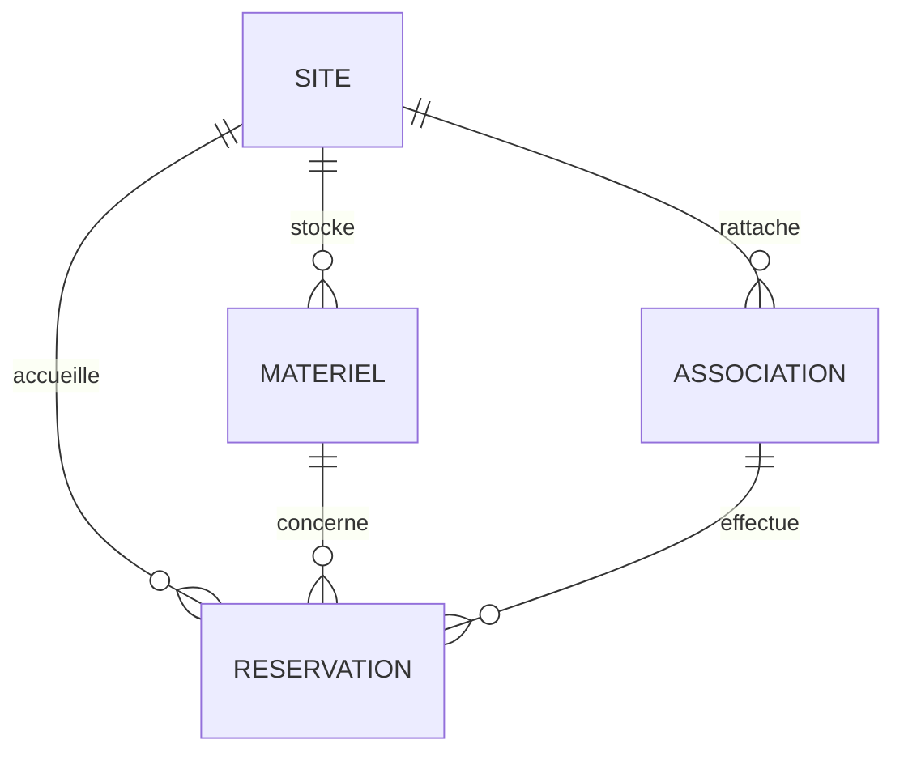

# Étape 4 — Modélisation du prêt de matériel

## MCD

### Entités et propriétés

- **Site** : `code_site`, `nom`, `commune`, `annee_ouverture`, `surface_m2`.
- **Materiel** : `id_materiel`, `reference`, `designation`, `categorie`, `etat`,
  `annee_achat`, `valeur_achat`.
- **Association** : `id_association`, `nom`, `type_association`, `commune`,
  `code_postal`, `date_convention`, `convention_active`.
- **Reservation** : `id_reservation`, `quantite`, `date_debut`,
  `date_fin_prevue`, `date_retour_reelle`.

### Associations et cardinalités



Chaque matériel, association et réservation dépend d'un seul site. Une
réservation concerne un seul matériel et une seule association. Un site, un
matériel ou une association peuvent exister sans réservation.

## MLD

- **site**(`code_site` CHAR(7) PK, `nom` VARCHAR(120) NOT NULL,
  `commune` VARCHAR(80) NOT NULL, `annee_ouverture` SMALLINT NOT NULL,
  `surface_m2` INTEGER NOT NULL)
- **materiel**(`id_materiel` INTEGER PK, `reference` VARCHAR(8) NOT NULL,
  `designation` VARCHAR(120) NOT NULL, `categorie` VARCHAR(40) NOT NULL,
  `etat` VARCHAR(20) NOT NULL, `annee_achat` SMALLINT NULL,
  `code_site` CHAR(7) NOT NULL FK → site.`code_site`,
  `valeur_achat` NUMERIC(8,2) NULL)
- **association**(`id_association` INTEGER PK, `nom` VARCHAR(150) NOT NULL,
  `type_association` VARCHAR(30) NULL, `commune` VARCHAR(80) NOT NULL,
  `code_postal` CHAR(5) NULL, `date_convention` DATE NOT NULL,
  `code_site` CHAR(7) NOT NULL FK → site.`code_site`,
  `convention_active` BOOLEAN NOT NULL)
- **reservation**(`id_reservation` CHAR(7) PK,
  `id_materiel` INTEGER NOT NULL FK → materiel.`id_materiel`,
  `id_association` INTEGER NOT NULL FK → association.`id_association`,
  `code_site` CHAR(7) NOT NULL FK → site.`code_site`,
  `quantite` INTEGER NOT NULL, `date_debut` DATE NOT NULL,
  `date_fin_prevue` DATE NOT NULL, `date_retour_reelle` DATE NULL)

## Justifications

1. `id_reservation` est conservé comme texte de longueur fixe (`CHAR(7)`).
2. Les identifiants tels que `R250000` ne sont pas des nombres à calculer.
3. Le type texte préserve leur préfixe et leur format métier.
4. `valeur_achat` utilise `NUMERIC(8,2)` pour stocker des montants exacts.
5. Un flottant peut introduire des erreurs d'arrondi ; il est déconseillé pour
   des valeurs monétaires.
6. `convention_active` est un booléen dans la base.
7. À l'import, `oui` devient `TRUE` et `non` devient `FALSE`.
8. `date_retour_reelle` accepte `NULL` car un matériel non rendu correspond à
   un prêt en cours, situation normale.
9. `materiel.code_site` indique le site où le matériel est stocké.
10. `association.code_site` indique le site de rattachement de l'association.
11. `reservation.code_site` conserve le site du retrait pour cette réservation.
12. Cette dernière valeur décrit l'opération et n'est pas une copie à supprimer.
13. Les trois colonnes sont donc des informations distinctes, chacune liée à
    `site.code_site` par une clé étrangère.
14. `annee_achat`, `valeur_achat`, `code_postal` et le type d'association
    peuvent être absents dans les données nettoyées ; ils restent `NULL`.
15. Les autres propriétés sont obligatoires pour décrire les entités et les
    prêts exploitables.

## Exécution du DDL

Créer la base une seule fois avec `createdb ccfl`, puis exécuter le script
depuis la racine du projet :

```powershell
psql -d ccfl -f Etape04/schema.sql
```

Le script supprime les tables de l'application dans l'ordre inverse des
dépendances avant de les recréer. Il peut ainsi être exécuté plusieurs fois.
